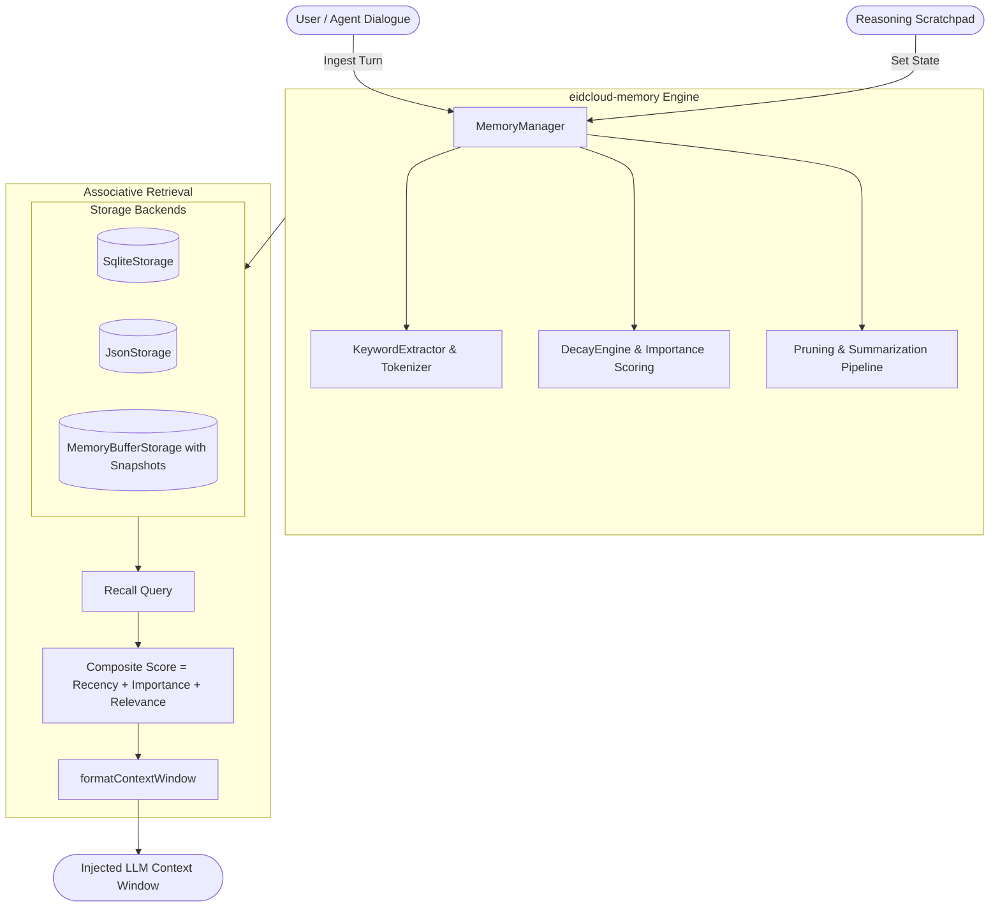

[🇸🇦 العربية](README.ar.md) | [🇬🇧 English](README.md)

# 🧠 eidcloud-memory

[](https://github.com/shadialhasan/eidcloud-memory/releases)
[](https://www.php.net)
[](LICENSE)
[](https://github.com/shadialhasan/eidcloud-memory/actions)
[](https://colab.research.google.com/github/shadialhasan/eidcloud-memory/blob/main/notebooks/quickstart.ipynb)

> **eidcloud-memory** is a zero-dependency, multi-tiered AI agent memory engine built in pure PHP 8.2+. It provides cognitive memory architectures (Short-Term, Working Memory Scratchpad, Long-Term Associative Knowledge, and Episodic Dialogue Turns) with exponential time decay, importance scoring, and automated consolidation.

---

## 🚀 Key Capabilities

- **Multi-Tiered Memory Architecture**:
  - `short_term`: Fast-decaying observations and contextual signals.
  - `working`: Active scratchpad for turn-by-turn agent reasoning and tool scratchpads.
  - `long_term`: High-importance facts, persistent knowledge, and consolidated memory digests.
  - `episodic`: Chronological dialogue interactions tagged with turn indices and agent roles.
- **Scoring & Decay Engine**:
  - Combined scoring formula: `Score = Recency + Importance + Relevance + AccessFrequencyBonus`.
  - Exponential half-life decay curves with configurable decay rates.
- **Maintenance, Pruning & Consolidation**:
  - Intelligent categorization: items are classified into `retain`, `summarize`, or `forget`.
  - Stale episodic items are consolidated into structured long-term summary digests.
- **Associative Keyword Retrieval**:
  - Lightweight lexical and token-overlap relevance scoring with fuzzy matching and tag prioritization—**zero external vector DBs or heavy dependencies required**.
- **Pluggable Persistence Drivers**:
  - `SqliteStorage`: High-performance embedded ACID storage using native PHP PDO SQLite.
  - `JsonStorage`: Flat JSON file storage for lightweight serverless or local environments.
  - `MemoryBufferStorage`: In-memory array storage with automated snapshotting thresholds.
- **Agent Integration Contracts**:
  - Native helper `formatContextWindow()` to generate compact prompt payloads for LLM context windows.
- **CLI Executable (`bin/eidcloud-memory`)**:
  - Inspect, store, query, prune, and view statistics directly from terminal environments.

---

## 📐 Architecture & Flowchart



---

## 📦 Installation

Ensure your environment is running PHP 8.2 or later:

```bash
php -v
```

Clone the repository directly (no Composer vendor installation required):

```bash
git clone https://github.com/shadialhasan/eidcloud-memory.git
cd eidcloud-memory
```

You can use the native PSR-4 autoloader at `src/autoload.php` or Composer PSR-4 autoloading:

```php
require_once __DIR__ . '/src/autoload.php';
```

---

## 🛠️ Quickstart Usage

### 1. Initializing Memory Manager
```php
<?php

use EidCloud\Memory\MemoryManager;
use EidCloud\Memory\Storage\SqliteStorage;
use EidCloud\Memory\Models\MemoryTier;

// Initialize with SQLite persistence (or ':memory:')
$manager = new MemoryManager(new SqliteStorage('agent_memory.db'));

// Store observations with importance and tags
$manager->remember(
    content: "User prefers concise responses with bullet points and dark mode themes.",
    tier: MemoryTier::SHORT_TERM,
    importance: 8.5,
    tags: ["preferences", "ui", "style"]
);
```

### 2. Dialogue & Working Memory Scratchpad
```php
// Log episodic dialogue turns
$manager->logEpisodicTurn('user', 'Can you deploy the API to production?', 1);
$manager->logEpisodicTurn('assistant', 'Starting deployment verification.', 2);

// Set active working memory scratchpad for active task
$manager->setWorkingMemory('current_task', 'Deploying API v1.0.0');
```

### 3. Associative Retrieval & Context Formatting
```php
// Query ranked memories
$results = $manager->recall("What are user preferences?", topK: 3);

foreach ($results as $item) {
    echo "Score: {$item->score} | {$item->content}\n";
}

// Generate prompt-ready LLM context window
$promptContext = $manager->formatContextWindow("deployment preferences");
echo $promptContext;
```

---

## 💻 CLI Tool

The repository includes a ready-to-run CLI tool in `bin/eidcloud-memory`:

```bash
# View help manual
php bin/eidcloud-memory --help

# Store a memory
php bin/eidcloud-memory store "User prefers dark mode" --importance=8 --tags="user,pref"

# Query memories
php bin/eidcloud-memory query "What are user preferences?" --top=5

# Inspect stats in JSON
php bin/eidcloud-memory stats --json

# Run maintenance and consolidation
php bin/eidcloud-memory prune
```

---

## 🧪 Testing

The repository includes a zero-dependency automated test runner:

```bash
php tests/run_tests.php
```

All 32 test cases verify keyword extraction, exponential decay, SQLite and JSON storage, memory buffer snapshots, dialogue logging, pruning consolidation, and context formatting with 100% pass rate.

---

## 📓 Google Colab Quickstart

Try out `eidcloud-memory` in an interactive cloud environment:
[](https://colab.research.google.com/github/shadialhasan/eidcloud-memory/blob/main/notebooks/quickstart.ipynb)

---

## 👤 Author & Maintainer

**Eng. MHD. Shadi AL-Hasan**  
- **Role:** Executive CTO & Enterprise Solutions Architect  
- **Email:** [mhd.shadi.alhasan@gmail.com](mailto:mhd.shadi.alhasan@gmail.com)  
- **Phone / WhatsApp:** [+963934005922](tel:+963934005922)  
- **Location:** Damascus, Syria  
- **GitHub:** [shadialhasan](https://github.com/shadialhasan)  

---

## 📄 License

This project is licensed under the MIT License - see the [LICENSE](LICENSE) file for details.  
Copyright (c) 2026 **MHD. Shadi AL-Hasan**. All rights reserved.
